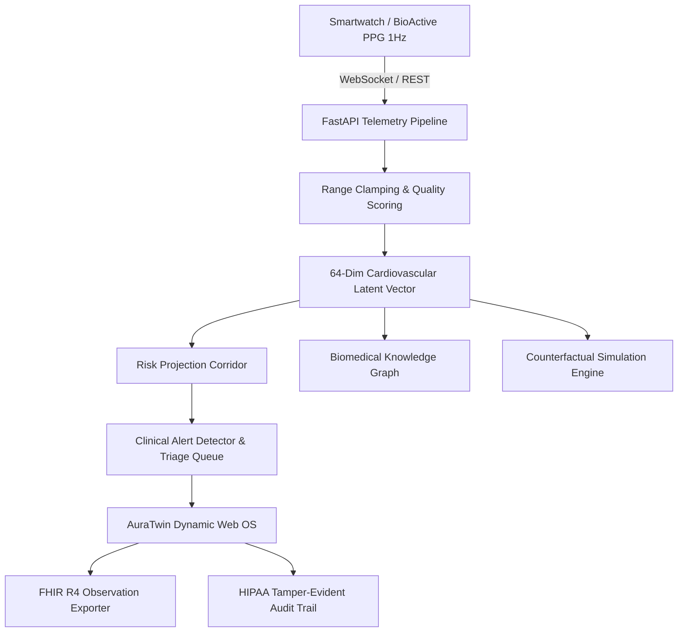

# AuraTwin: Autonomous Cardiovascular Digital Twin & 24/7 Wearable RPM Platform

[](https://fastapi.tiangolo.com)
[](https://python.org)
[](https://tailwindcss.com)
[](LICENSE)
[](#security--governance)

**AuraTwin** is a high-performance clinical digital twin platform and autonomous remote patient monitoring (RPM) operating system designed for continuous 24/7 wearable sensor telemetry, real-time hemodynamic state estimation, and automated clinical alarm triage.

---

## Table of Contents
- [Key Features](#key-features)
- [System Architecture](#system-architecture)
- [Role-Based Access Control (RBAC)](#role-based-access-control-rbac)
- [Quickstart Guide](#quickstart-guide)
- [API Reference](#api-reference)
- [Wearable Telemetry Engine](#wearable-telemetry-engine)
- [Project Structure](#project-structure)
- [Security & Governance](#security--governance)
- [License](#license)

---

## Key Features

### 1. Dual Visual & Text Real-Time Vital Measurement Cards
- Continuous monitoring across 8 vital parameters:
  - **Heart Rate (HR)**: `60 - 100 bpm`
  - **Heart Rate Variability (HRV)**: `30 - 100 ms`
  - **Oxygen Saturation (SpO2)**: `95 - 100%`
  - **Respiration Rate (Resp)**: `12 - 20 rpm`
  - **Systolic Blood Pressure (SBP)**: `90 - 140 mmHg`
  - **Diastolic Blood Pressure (DBP)**: `60 - 90 mmHg`
  - **Core Body Temperature**: `36.1 - 37.5 °C`
  - **Blood Glucose**: `70 - 140 mg/dL`
- Dual representation: Visual target range bars with animated calibration needles alongside numerical values, measurement units, physiological normal reference bounds, and real-time deviation flags.

### 2. 24/7 Continuous Smartwatch Telemetry Stream
- Generates realistic AR(1) biometric telemetry streams at 1 Hz mimicking medical-grade wearable sensors (Apple Watch Ultra / BioActive PPG optical cluster).
- Real-time animated canvas rendering of dual-channel continuous **Lead II ECG** and **Arterial PPG pulse** waveforms with glowing phosphor scanheads.

### 3. Segmented Clinical Alert Queue & Rapid Acknowledgment Modal
- Partitioned into two distinct clinical segments:
  - **🔴 Non-Acknowledged Alerts (Active Clinical Queue)**: Highlighted, prioritized by urgency and sorted newest first.
  - **✓ Acknowledged Alerts (Audit Verified & Signed-off)**: Verified records displaying timestamped clinician signatures.
- Dedicated clinical sign-off modal with instant queue advance and auto-focusing on the next unacknowledged alarm.

### 4. Interactive What-If Counterfactual Lab & Drug Trials
- Real-time simulation of medical interventions:
  - **Beta-Blocker Titration (25% / 50% / 75%)**: Down-regulates heart rate and myocardial oxygen demand.
  - **ACE Inhibitors**: Vasodilation modeling with systemic vascular resistance (SVR) reduction and blood pressure moderation.
- Dynamic comparison curves against baseline cardiovascular trajectories.

### 5. Latent 64-Dim State Space Heatmap & Explainability
- Dense 64-dimensional physiological embedding tracking:
  - Slots 0–7: Core vitals (HR, SBP, DBP, SpO2, Resp, Temp, Glucose, HRV).
  - Slots 8–15: Derived hemodynamics (Mean Arterial Pressure, Pulse Pressure, Shock Index, Rate Pressure Product).
  - Slots 16–63: Latent cardiodynamic representations.
- Permutation-based occlusion explainability quantifying feature attribution for clinical risk forecasting.

### 6. Relational Graph Convolutional Network (RGCN) Medical Knowledge Graph
- Visualizes relational entity graphs linking patient nodes to physiological observations, clinical conditions, pharmacological agents, and adverse risk corridors.

### 7. Interoperability & Standards Compliance
- **FHIR R4**: Export and download compliant observation bundles using LOINC codes (Heart Rate `8867-4`, SBP `8480-6`, DBP `8462-4`, SpO2 `2708-6`, Temp `8310-5`).
- **HIPAA Security Rule**: Immutable tamper-evident audit logging recording user, action, resource, timestamp, and network IP.

---

## System Architecture



---

## Role-Based Access Control (RBAC)

AuraTwin features role-tailored feature partitioning across 4 distinct user profiles:

| Role | Default Username | Default Password | Workspace Scope |
| :--- | :--- | :--- | :--- |
| **Clinician** | `clinician` | `demo123` | Remote Patient Monitoring, Alert Triage & Acknowledgment, Smartwatch Telemetry Stream, What-If Lab |
| **Admin** | `admin` | `demo123` | Superuser Access, System Telemetry Pipeline, Exclusive Access to the HIPAA Audit Log (`/audit`) |
| **Researcher** | `researcher` | `demo123` | 64-Dim Latent Heatmap, RGCN Knowledge Graph, Counterfactual Simulation Lab, Occlusion Explainability |
| **Patient** | `patient` | `demo123` | Personalized "My Live Vitals" Dashboard, Personal Health History for `P001`, FHIR R4 Bundle Export |

---

## Quickstart Guide

### Prerequisites
- Python 3.10 or higher
- pip package manager
- Git

### Installation & Launch

```bash
# 1. Clone the repository
git clone https://github.com/urk23cs7091/auratwin-cardiovascular-os.git
cd auratwin-cardiovascular-os/twin

# 2. Install dependencies
pip install -r requirements.txt

# 3. Start the application server
python -m uvicorn app.main:app --host 0.0.0.0 --port 8000 --reload
```

Open your browser and navigate to **`http://localhost:8000`**.

### Running Automated Test Suite

```bash
pytest -q
```

---

## API Reference

| Method | Endpoint | Description | Role Barrier |
| :--- | :--- | :--- | :--- |
| `POST` | `/auth/login` | Authenticate user & issue signed JWT token | Public |
| `GET` | `/patients` | List active digital twin patients | Authenticated |
| `GET` | `/patients/{id}/state` | Fetch 64-dimensional latent state vector | Authenticated |
| `GET` | `/patients/{id}/risk` | Multi-horizon risk corridor projections (3h, 12h, 24h, 7d) | Authenticated |
| `GET` | `/patients/{id}/explain` | Occlusion sensitivity feature attribution | Authenticated |
| `POST` | `/telemetry` | Ingest real-time wearable sensor packet | Authenticated |
| `WS` | `/ws/telemetry/{id}` | WebSocket stream for continuous 1 Hz biometrics | Authenticated |
| `GET` | `/alerts` | Retrieve segmented clinical alert queue | Authenticated |
| `POST` | `/alerts/{id}/ack` | Clinician sign-off & acknowledgment of an alarm | Clinician, Admin |
| `POST` | `/simulations` | Execute counterfactual drug trial simulations | Clinician, Admin, Researcher |
| `GET` | `/graph/{id}` | Retrieve RGCN relational biomedical knowledge graph | Authenticated |
| `GET` | `/rollout/{id}` | Generate 24-hour hemodynamic trajectory rollout | Authenticated |
| `GET` | `/fhir/{id}/bundle` | Export LOINC-coded FHIR R4 Observation bundle | Authenticated |
| `GET` | `/audit` | Query immutable HIPAA security audit trail | Admin Only |

---

## Wearable Telemetry Engine

The simulation engine models an Apple Watch Ultra equipped with a multi-wavelength photoplethysmography (PPG) optical sensor. Telemetry data is generated using an autoregressive $AR(1)$ physiological drift model:

$$x_t = c + \phi x_{t-1} + \epsilon_t, \quad \epsilon_t \sim \mathcal{N}(0, \sigma^2)$$

When simulated exertion or arrhythmia occurs, parameters seamlessly transition beyond normal clinical thresholds, triggering real-time alerts on the clinician queue and dashboard.

---

## Project Structure

```
auratwin-cardiovascular-os/
├── LICENSE                 # MIT License
├── README.md               # Project documentation
├── .gitignore              # Git ignore rules for databases and caches
└── twin/
    ├── Dockerfile          # Production Docker configuration
    ├── README.md           # Application documentation
    ├── requirements.txt    # Python dependencies (FastAPI, uvicorn, pytest)
    ├── app/
    │   ├── __init__.py
    │   ├── core.py         # SQLite engine, PBKDF2 hashing, JWT (HS256), HIPAA audit log
    │   ├── services.py     # State vector derivation, risk corridors, simulations
    │   ├── services_ext.py # RGCN graph generator, FHIR R4 builder, explainability
    │   └── main.py         # FastAPI application, WebSocket telemetry, RBAC routes
    ├── static/
    │   └── index.html      # Responsive Single Page Application, Tailwind CSS, Chart.js
    └── tests/
        └── test_flow.py    # Automated test suite for end-to-end flow & RBAC barriers
```

---

## Security & Governance
- **Immutable Audit Trail**: All authentication attempts, alert acknowledgments, and sensitive data accesses are permanently logged with timestamps, role badges, and source IPs.
- **Strict Role-Based Authorization**: Protected endpoints return HTTP 403 Forbidden when accessed without appropriate role claims.
- **Zero Plaintext Passwords**: Password verification uses PBKDF2 with SHA-256 and cryptographic salts.

---

## License
Distributed under the MIT License. See [LICENSE](LICENSE) for details.
